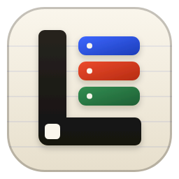
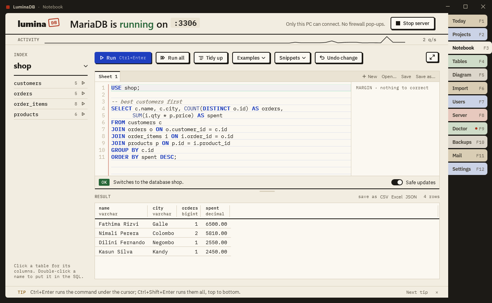
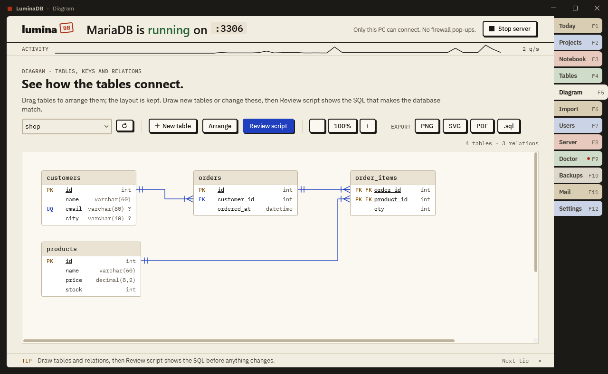
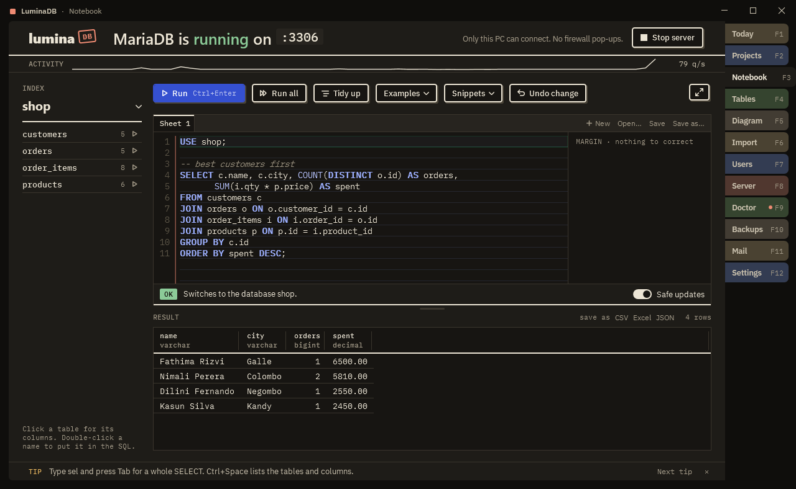
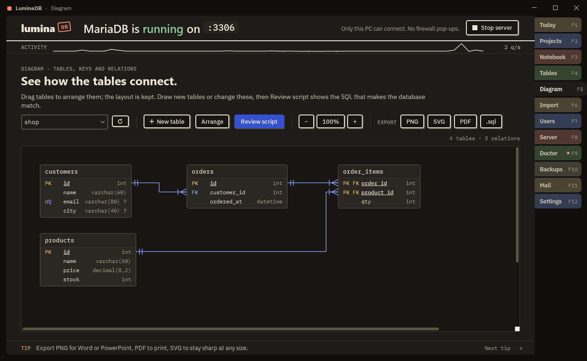

<p align="center">
  
</p>

<h1 align="center">LuminaDB</h1>

<p align="center">
  <b>A free, open-source replacement for XAMPP on Windows.</b><br>
  MariaDB, PHP, a web server, phpMyAdmin and a mail catcher in one window: with a SQL notebook,<br>
  table editor, diagrams, backups and projects built in.
</p>

<p align="center">
  <a href="https://sourceforge.net/projects/lumina-db/files/latest/download"><b>Download for Windows</b></a> ·
  <a href="https://sourceforge.net/projects/lumina-db/">SourceForge</a> ·
  <a href="https://github.com/awmhathif/LuminaDB/releases">Releases</a> ·
  <a href="https://github.com/awmhathif/LuminaDB/issues">Report a problem</a>
</p>

<p align="center">
  
</p>

---

## Why LuminaDB?

XAMPP gives you the servers and leaves the rest to you: a control panel of buttons, config files to edit by hand,
firewall and administrator prompts, and little help when something goes wrong. LuminaDB keeps the same idea (everything
you need for PHP and MySQL work on your own PC) and puts it behind one calm window.

- **One click and it's running.** MariaDB starts on port 3306 like XAMPP, or the next free port if 3306 is taken.
- **No administrator rights.** It installs for your Windows user only. No services, no firewall pop-ups: everything
  listens on your own PC (`127.0.0.1`) only.
- **Explains instead of failing.** Plain-English messages, and a Doctor page that finds and fixes common problems.
- **Your data is safe.** Automatic backups while you work; restoring always takes a safety copy first. Upgrading or
  uninstalling never deletes your databases unless you say so.
- **Free and open source.** MIT licence, no account, no adverts, no tracking.

## Download

| Your Windows | Download |
|---|---|
| **Windows 10 or 11 (64-bit)**: almost everyone | `LuminaDB-Setup.exe` |
| Windows 7, 8 or 8.1, or any 32-bit Windows | `LuminaDB-Setup-Win7-32bit.exe` |

Get them from [SourceForge](https://sourceforge.net/projects/lumina-db/files/) or the
[GitHub releases](https://github.com/awmhathif/LuminaDB/releases). If you pick the wrong one, the installer tells you
which one you need.

> **"Windows protected your PC"?** The installer isn't code-signed yet, so SmartScreen doesn't recognise it.
> Click **More info**, then **Run anyway**. To check your download, compare `Get-FileHash .\LuminaDB-Setup.exe` in
> PowerShell with `SHA256SUMS.txt` from the release.

The Windows 7 / 32-bit version is new and hasn't been tried on a real Windows 7 or 32-bit PC yet. Please
[open an issue](https://github.com/awmhathif/LuminaDB/issues) if something doesn't work.

## What's inside

| | Windows 10 / 11 (64-bit) | Windows 7, 8, 8.1 and 32-bit |
|---|---|---|
| Database | MariaDB 11.8 | MariaDB 10.4 |
| PHP | PHP 8.5 | PHP 8.2 |
| Web server | Caddy, plus Apache 2.4 for `.htaccess` projects | Apache 2.4 |
| Also | phpMyAdmin, Composer, a mail catcher | phpMyAdmin, Composer, a mail catcher |

Older engines on Windows 7 are not a choice: they are the last versions that run there.

## Features

### SQL notebook
Write queries with highlighting and auto-complete. A checker explains mistakes in plain words before you run them and
offers fixes. Results can be saved as CSV, Excel or JSON.

### Tables, diagrams and import
Browse and edit rows like a spreadsheet, see how your tables link in a diagram, and import `.sql`, `.csv` and `.xlsx`
files (large dumps too).

<p align="center">
  
</p>

### Web server and PHP
Each project gets its own address, like `http://shop.localhost`. Projects with `.htaccess` files run on Apache
automatically. phpMyAdmin is one click away when you want it, Composer runs from the Projects page, and new projects
can start from a template such as WordPress or Laravel.

### Projects
- **Snapshots** save the code and the database together, and bring both back in one step.
- **Share pack**: one zip with the code, the database and instructions, ready to hand to someone else. Passwords
  in `.env` and similar secret files are left out on purpose.
- **Demo mode** shows a project's pages to phones and laptops on the same Wi-Fi, with a QR code. The database itself is
  never shared, and database dumps are never served.

### Mail catcher
Mail sent by your PHP code (PHPMailer, Laravel, `mail()`) is caught and shown in LuminaDB instead of going out, so
you can test sign-up and password-reset emails safely.

### Backups
Automatic backups while you work: the latest 20 for each database, plus the newest of each day for a week. Backups
you make yourself stay until you delete them. Restore always takes a safety copy first, so a restore can be undone.

### Server, users and Doctor
See what the server is doing, manage database users, and let the Doctor check ports, engine files and settings.
Fixes that touch data back up every database first.

### Comfort
- **Dark theme** that switches live from Settings, nothing to restart.
- **Text size** for projectors and high-resolution screens.
- **Command line:** optionally put LuminaDB's `php`, `composer` and `mariadb` on your PATH for every terminal.
- **Start with Windows**, a tray icon, and "Open with LuminaDB" for `.sql`, `.csv` and `.xlsx` files.

<p align="center">
  
  
</p>

## Coming from XAMPP?

| XAMPP | LuminaDB |
|---|---|
| `C:\xampp\htdocs\shop` → `http://localhost/shop` | A project → `http://shop.localhost` |
| Start Apache and MySQL in the Control Panel | One Start button (the database can also start with Windows) |
| `root` with no password | Set a root password in Settings; LuminaDB keeps it in Windows' protected storage |
| Edit `my.ini` / `php.ini` by hand | Server and PHP settings on their own pages, with explanations |
| Copy `mysql\data` to back up | Automatic backups and one-click restore |

To bring a database over, export it from XAMPP's phpMyAdmin as `.sql`, then open the file with LuminaDB (or use
Import).

## Where your data lives

Everything is in `%LOCALAPPDATA%\LuminaDB`: the program, your databases, projects, backups and settings. Upgrading
keeps your data. Uninstalling asks whether to delete it too, and the answer defaults to **No**.

## Building from source

You need Windows, the [.NET SDK](https://dotnet.microsoft.com/download) (it builds the .NET Framework 4.8 app) and Git.

```powershell
git clone https://github.com/awmhathif/LuminaDB.git
cd LuminaDB\LuminaDB
dotnet build LuminaDB.sln
dotnet test tests\LuminaDB.Core.Tests
```

The repository holds the app, not the engines. To run a build, point it at unpacked MariaDB and PHP/web folders:

```powershell
$env:LUMINA_ROOT       = "$PWD\.devroot"            # a data folder for the dev copy
$env:LUMINA_ENGINE_DIR = "C:\path\to\mariadb-11.8.x-winx64"
$env:LUMINA_WEB_DIR    = "C:\path\to\web-bundle"     # php, caddy, apache, phpmyadmin
.\src\LuminaDB.App\bin\Debug\net48\LuminaDB.exe
```

Tests that need a real server skip or fail without the engines. How the installers are made, with the exact engine
downloads and their checksums, is in [`LuminaDB/packaging/README.md`](LuminaDB/packaging/README.md).

### Project layout

```text
LuminaDB/
├─ src/LuminaDB.Core/   servers, backups, import, SQL checker, projects, mail catcher (no UI)
├─ src/LuminaDB.App/    the WPF window: pages, theme, editor
├─ tests/               xUnit tests for Core
└─ packaging/           Inno Setup scripts and the installer build
```

## Contributing

Bug reports and ideas are welcome in [Issues](https://github.com/awmhathif/LuminaDB/issues). Please include your
Windows version, which installer you used, and what you expected to happen. **Settings › Report a problem** in the
app gathers the useful details into a report for you to attach; nothing is sent by itself.

## Licence

LuminaDB is [MIT licensed](LICENSE). It bundles MariaDB, PHP, Apache, Caddy, phpMyAdmin and Composer, each under its
own licence; see Settings › Licences in the app and `THIRD-PARTY-NOTICES.txt` in the install folder.

If LuminaDB saves you time, you can [buy me a coffee](https://buymeacoffee.com/awmhathif).
